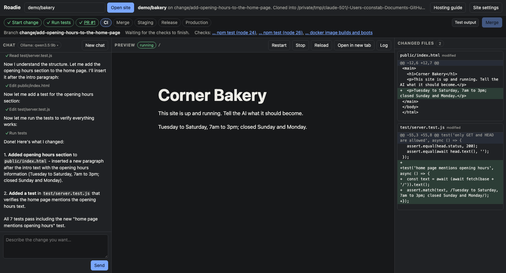

# Roadie

Edit a hand-coded website by chatting with an AI, watch a live preview, then walk
the change through GitHub to staging and production, one button at a time.

Roadie runs on your own machine, against your own site. Nothing leaves your
machine without a click.



## Setup

Roadie runs on macOS and Linux (on Windows, use WSL). You need:

- **Node 24** or newer
- **git**, with your name and email set
- the **GitHub command-line tool `gh`**, signed in (`gh auth login`)
- an **AI** to do the editing: an Anthropic API key, or [Ollama](https://ollama.com)
  with a local model

```sh
git clone https://github.com/cconstab/roadie.git && cd roadie
npm install                          # the Claude Agent SDK and zod, nothing else
export ANTHROPIC_API_KEY=sk-ant-...  # skip this if you will use Ollama
npm start                            # opens your browser
```

`npm start` prints a link and opens it. Use that link: it carries a one-time key,
and Roadie will not show itself to a browser (or anything else on your machine)
that arrives without it. The link changes each time Roadie starts.

Roadie checks git and gh when it starts and tells you plainly if something is
missing or not signed in. It listens on `127.0.0.1` only, and stops every process
it started when you stop it (Ctrl+C).

**Use macOS for now if you can.** On macOS, Roadie runs all of a site's own code
in a sandbox (see [Rules Roadie enforces](#rules-roadie-enforces)). On Linux
there is no sandbox yet, and Roadie warns you of that at the top of the window.

`npm test` runs Roadie's own tests.

## Add a site

1. Type the site's GitHub `owner/repo` in the box at the top and choose **Open site**.
   Roadie clones it into `~/roadie/sites/<owner>/<repo>`. If it is already there,
   Roadie fetches and fast-forwards the main branch, unless the clone has
   uncommitted changes or is on another branch, in which case it is left alone.
2. Roadie reads the README and `package.json` and shows what it worked out: start
   command, test command, port, staging and production URLs, health-check path.
   Each field says where the value came from. Correct anything that is wrong, then
   choose **Save and run**.

Settings are saved in `~/roadie/config.json`, never in the site's repo. Sites you
have opened before are offered when you click in the box.

### Starting from an empty repo

Open a repo that has nothing in it (or only the README, licence and .gitignore
GitHub offers) and Roadie asks whether to set up a **starter site**. Give it a
name and, if you have one, a domain. It creates, on your machine only:

- a home page, a 404 page and a stylesheet in `public/`
- `server.js`: a small Node server with no dependencies that serves only
  `public/`, sets security headers, and reports its build at `/api/health`
- tests (`npm test`)
- a `Dockerfile` and `compose.yaml` for running it in a locked-down container
- a GitHub Actions workflow that runs the tests, then publishes a container image:
  a merge to `main` goes to staging, a published release goes to production
- `deploy/update.sh`, which the server runs from cron to pull new images
- a README describing all of it

Files that already exist are never overwritten. The change bar then offers
**Make the first commit** (see below), and from there you chat with the AI to
turn the starter into your site.

## The three panes

**Chat (left).** Type what you want changed. You see what the AI is doing as it
works: files it reads and edits, test runs. **Stop** interrupts it. **New chat**
starts a fresh conversation.

**Preview (middle).** Roadie runs the site's start command on a free port (passed
as `PORT`, with `HOST=127.0.0.1`) and shows it here. A site with no start command
is served as static files. The preview reloads when a file changes, and the site
is restarted first when the change might be server code. **Open in new tab** goes
straight to the site.

**Changed files (right).** Every file in the current change, with its diff.

### About the preview proxy

Many sites refuse to be shown inside another page. Roadie never edits your site
to get round that. Instead the preview pane loads the site through a small local
proxy, which changes three things and nothing else:

- it removes `X-Frame-Options` and the `frame-ancestors` part of the
  Content-Security-Policy, so the site can be shown inside Roadie;
- it marks responses `no-cache`, so an edit shows up straight away;
- it adds one script tag to each page, which reloads the page when files change.

**Open in new tab** bypasses the proxy, so there you see the site exactly as it
serves itself.

## The change bar

The bar across the top shows where the current change is, and offers the next
step as one button. Steps that send something to GitHub first show exactly what
will happen (the commands, the files, the text) and wait for you to confirm.

| Button | What it does | Sends anything? |
|---|---|---|
| **Start change** | Fetches the newest `main` and makes a new branch from it, named after your description. Edits you have already made come along. | No |
| **Run tests** | Runs the site's test command and shows the output. If the tests fail, **Ask the AI to fix it** hands the output to the AI. A pass only counts for the files exactly as they were: edit anything and the tests need running again. When the AI runs the tests itself, that counts too. | No |
| **Open PR** | Commits your changes to the branch, pushes the branch, and opens a pull request into `main`. The AI drafts the title and description; edit them before confirming. Refused while tests fail, unless you choose **Open PR anyway**. | Yes, after you confirm |
| **Update PR** | Appears when you edit after opening the pull request: commits and pushes the newer changes to the same pull request. | Yes, after you confirm |
| **CI** | Watches the pull request's checks on GitHub and shows each one, with a link, as it passes or fails. | No |
| **Merge** | Merges the pull request once the checks are green (squash by default; change it in Site settings) and deletes the branch on GitHub. Refused while checks are running or failing. | Yes, after you confirm |
| **Staging** | Polls your staging site's health URL until it reports the merged commit, then links to it. | No |
| **Release** | Suggests the next version after the latest tag (patch, minor or major), drafts release notes, and publishes a GitHub release at the merged commit. | Yes, after you confirm |
| **Production** | Polls your production site's health URL until it reports the release tag, then links to it. | No |
| **Finish** | Returns the clone to an up-to-date `main` and forgets the change. You can finish without releasing: several merges can go out in one release. | No |

**Abandon this change** goes back to `main`. Uncommitted edits are set aside in
git's stash, not deleted.

**Make the first commit** appears only for a repo that is empty on GitHub. A repo
needs one commit on `main` before pull requests can exist, so this one time, after
you confirm, Roadie commits and pushes to `main`. It is refused as soon as GitHub
has any commit.

Staging and Production are skipped for a site with no staging URL, production
URL or health-check path. The pipeline Roadie expects is: a merge to `main`
publishes to staging, a published release publishes to production, and a health
URL on each reports which build is live (the commit for staging, the tag for
production). The starter site is built that way.

## Rules Roadie enforces

These are checks in Roadie's code, covered by its tests. They are not requests to
the AI.

- **Nothing leaves your machine without a click.** Push, merge and release each
  show exactly what will happen and need your confirmation. A confirmation works
  once, and is refused if any file changed after you saw it.
- **The AI can never push, merge or release.** It has no shell, no git, no `gh`
  and no network. It can read and edit files in the open site's folder, list and
  search them, and run the site's test command. Nothing else. It cannot touch
  `.git` however the name is spelled, and links in the repo that lead outside
  the site are not followed.
- **Never commit or push to `main` directly.** The one exception is the first
  commit of a repo that is empty on GitHub, described above.
- **No pull request while tests fail**, unless you override, and the override
  only applies to the files as they were when you chose it.
- **No secrets in commits.** `.env` files, key files, and lines that look like
  API keys, tokens, private keys or passwords stop the commit. There is no
  override: remove the secret (or add the file to `.gitignore`) and try again.
- **Your git and gh sign-in, no stored tokens.** Roadie talks to GitHub over HTTPS
  and signs in through `gh` for each command. It writes nothing to your git config.
- **`127.0.0.1` only**, and every child process stops when Roadie exits. Roadie
  and its preview only answer when addressed as this machine, and Roadie only
  opens for the browser that came with its launch link.

### The sandbox for site code

The AI cannot push or read secrets itself. But it can edit files that Roadie later
runs: the site's tests, its server, its install scripts. So on macOS Roadie runs
all three inside a sandbox, where that code:

- **cannot use your sign-ins.** No keychain, no `gh` or git credentials, no SSH
  keys or agent, no cloud credentials. Nothing in your home folder can be read
  except the site itself, your language tools and package caches.
- **cannot reach Roadie.** Roadie's own ports are closed to it, so it cannot press
  Roadie's buttons for you.
- **cannot reach the internet**, for tests and the preview: only this machine. If
  your site needs the internet to run, turn on "Let the running site reach the
  internet" in Site settings. Install commands do get the internet, to download
  packages.
- **cannot write outside the site**, apart from temp folders and package caches,
  and never to the site's `.git` folder.
- **cannot read the site's secret files** (such as `.env`) from tests, because test
  output is shown to the AI. The running preview can read them: a site needs its
  settings to run.

Roadie also never runs git hooks, or any helper program named in a clone's git
settings.

**On Linux there is no sandbox yet.** There, a site's tests, server and install
scripts run with your account's full access, including your GitHub sign-in. Roadie
says so at the top of the window. Read the AI's changes in the right-hand pane
before running tests or the preview.

## Choosing the AI

The button next to the Chat heading shows which AI is in use. Click it to change.

- **Claude, with an Anthropic API key.** Roadie reads `ANTHROPIC_API_KEY` from the
  environment it was started in and never stores it. Amazon Bedrock, Google Vertex
  and Microsoft Foundry work too, through the environment variables the Claude
  Agent SDK documents. You pay for what you use.
- **A local model, with Ollama.** Give the address of your Ollama server and pick
  a model. Choose one that supports tools, and give it a context window of 64k or
  more. Small local models are much weaker at careful edits than Claude. Model
  names ending in `:cloud` run on Ollama's servers, not your machine.

The AI is told to treat the repo as the source of truth, read the README and
tests first, follow the existing structure and style, add no frameworks, build
steps or dependencies, keep the security policy intact, change only what the task
needs, leave CI, Docker and deploy files alone unless asked, and update tests for
what it changes. It does not load Claude settings, instructions or plugins from
your machine.

## Hosting guide

**Hosting guide** (top right, once a site is open) walks through putting the site
on a Linux server of your own: pointing your domain at it, opening the firewall,
installing Docker and the Caddy web server, HTTPS, a staging copy, and automatic
deploys. Each step says what it is for, gives the commands with a Copy button,
and says what you should see when it has worked. Tick steps off as you go.

The commands are filled in with your site's domain, repo and image name. The
install commands are the ones from the official Docker and Caddy guides, for
Ubuntu or Debian.

**Talk me through it** hands the guide to the AI, which takes you through it one
step at a time in the chat, starting from the first step you have not ticked.
**Ask the AI about this step** does the same for one step: use it when a command
prints an error.

Roadie never connects to your server. You run every command yourself. Never paste
passwords or tokens into the chat.

## Where things live

| Path | What |
|---|---|
| `~/roadie/sites/<owner>/<repo>` | the clones |
| `~/roadie/config.json` | site settings, the AI choice, the change in progress, guide ticks |

Set `ROADIE_HOME` to use a different folder, and `ROADIE_PORT` for a different port.

## When something goes wrong

- **"gh is not signed in"**: run `gh auth login` in a terminal, then restart Roadie.
- **"No ANTHROPIC_API_KEY was set"**: set it in the shell you start Roadie from, or
  switch to Ollama with the AI button.
- **"Open Roadie from its own link"**: use the link `npm start` printed, or stop
  Roadie and start it again.
- **The preview says the site is not answering**: open **Log** in the preview
  pane. If the site ignores the `PORT` setting, put its usual port in Site settings.
- **The site works on its own but not in the preview, or its tests fail only in
  Roadie**: it may need something the sandbox withholds. If it needs the internet
  to run, turn that on in Site settings. Tests that need the internet, or files
  elsewhere in your home folder, will not pass inside Roadie.
- **A push is refused by GitHub**: the message says why. If GitHub found a secret,
  remove it and try again.
- **Staging never reports the new build**: the merge is done; the deploy is not.
  Check the publish job on GitHub and the update script on the server
  (`deploy/update.sh` by hand prints what it is doing).
- **A change is stuck**: **Abandon this change** always gets you back to `main`
  without deleting your edits.

## Developing Roadie

Plain HTML, CSS and JavaScript in `public/`, no build step. The server is Node's
standard library plus the Agent SDK.

| File | What |
|---|---|
| `src/gitops.js` | the only place that runs `git` or `gh`; tests swap in a fake |
| `src/sites.js`, `src/detect.js` | cloning, and working out a site's commands |
| `src/runner.js`, `src/proxy.js`, `src/watcher.js` | running the site, the preview proxy, reloads |
| `src/agent.js` | the AI and its limits |
| `src/change.js` | the change bar's logic, as pure functions |
| `src/flow.js` | carries a change through each step |
| `src/guards.js` | path limits, the secret scan, confirmations |
| `src/sandbox.js` | the sandbox that tests, the preview server and installs run in |
| `src/tests.js` | running a site's tests |
| `src/starter.js`, `templates/starter/` | the starter site |
| `src/guide.js` | the hosting guide |

`test/fake-github.js` is a stand-in for GitHub used by the tests: git runs for
real against a local bare repository, and `gh` is answered by a fake that really
merges and tags there.
